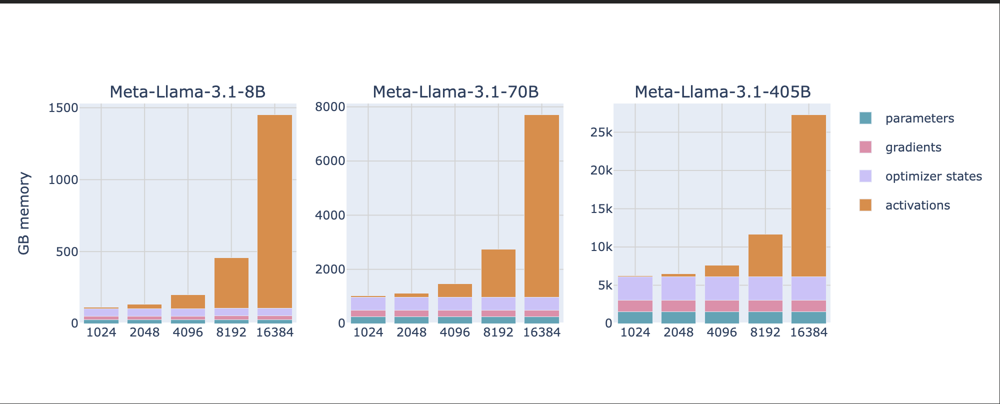
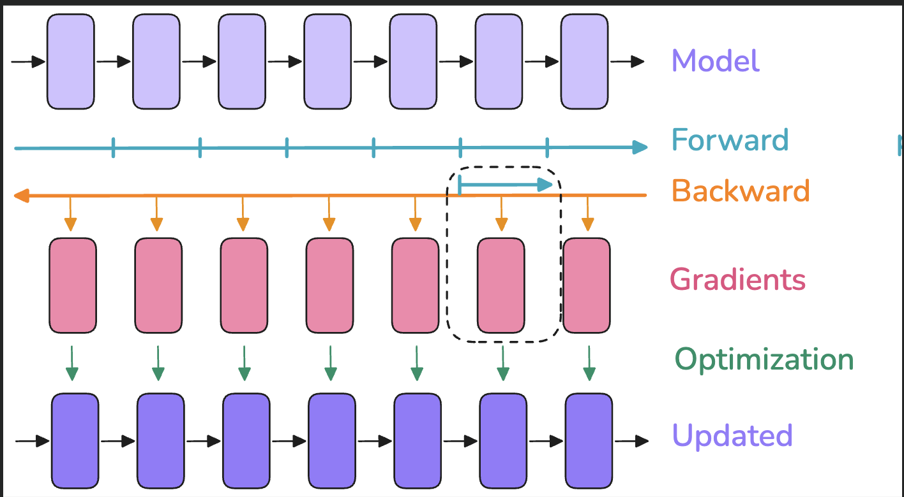

Source: [Nanotron Ultra Scale](https://huggingface.co/spaces/nanotron/ultrascale-playbook?section=profiling_gpu_compute_and_communication)

- It's easier to talk about an LLM input as a volume of tokens per batch i.e., b * seq. Usual size is 4-60 million tokens per batch.
- DeepSeek was trained with a batch size of ~60M tokens for 14 trillion tokens.
- Memory is used for model weights, model gradients, optimizer states, Activations that are needed to compute the gradients. 
- The general training cycle is: forward pass (computes activations), backward pass (updates gradients), optimizer step (updates model weights).
- When you profile, forward pass computes all the activations. These activations are used for updating weights later. Therefore, these activations are preserved. For example, say, `Y = X * W` where `W` is the learnable weight matrix. Gradient `dL/dW = dL/dY * dY/dW` i.e., `dL/dW = X.T * dL/dY`. Therefore we preserve `X` along the path. 
- For a Transformer, these activations include the FFN layer coefficient matrix; the pre-attention matrix that is split into Q,K,V; the quadratic attention matrix that is of size seq * seq etc., All these matrices are preseved in the memory during the forward pass and this builds up memory. 
- Total number of params in a GPT: `N = h * v + L * (12*h^2 + 13*h) + 2*h`. Where L is the number of layers, h is the hidden dim, v is the vocab size.
    - `h * v`: token embedding, shared with the output head (weight tying). Without tying it's `2 * h * v`.
    - `12*h^2` per layer: Q,K,V projections `3h^2` (output is `3h` dim, chunked into Q,K,V before the head split) + output projection before MHA output `h^2` (to mix the heads) + FFN upsize `4h^2` + FFN downsize `4h^2`.
    - `13*h` per layer: biases on every linear layer (`3h` QKV + `h` out + `4h` FFN up + `h` FFN down = `9h`) + 2 LayerNorms with γ and β each (`2 * 2h`).
    - `2*h`: the final LayerNorm before the output head.
- Assuming a fp32, memory footprint for a typical model is:
    - m_params = `4N`
    - m_grads = `4N`
    - m_optim = `(4 + 4) * N` (optim needs moment 1 and moment 2)
- Assuming a mixed precision, bf16, memory footprint for a typical model is:
    - m_params = `2N`
    - m_grads = `2N`
    - m_params_fp32 = `4N`
    - m_optim = `(4 + 4) * N` (optim needs moment 1 and moment 2)
Note on why Mixed precision: a weight update is `lr × grad`, which is tiny, something like 0.0001. So, we multiply the learning rate with the master grad copy and then cast that to bf16 to update the weights. Note that mixed precision training saves nothing over full precision training but the inference and training are 2x faster. 
- There is a complex formula for memory requirement for activation weights. Not including it here. In short, memory footprint scales linearly with batch size and scales quadratically with seq length. This means the activation memory is the part that will blow up when we increase our batch size or train with longer sequences.
- For Llama models, increasing context length with batch size = 1 blows up activation weights quadratically. For large numbers of input tokens (i.e., large batch sizes/sequences), activations become by far the largest memory burden. 
- Activation Recomputation: Say, we have `Y = X * W` and we need to compute gradient to update `W`. We could either store `X` or we could recompute `X`. In Transformers, paper figured that discarding MHA internals and recomputing it saves 70% memory with only 2.7% extra compute cost with everything else (FFN, layer norms etc.,) intact in the memory!! This is called "selective approach".
- Gradient checkpointing: Save activations (`X`s) at the start of the block and drop everything else inside the blocks from memory. When the backward pass reaches layer 11, rerun the forward pass for that one block from its saved input, get X, compute the gradients, and free that memory. Then move on to layer 10. Below figure describes it the best. 'Checkpoint' in the sense, we recompute from the nearest checkpoint.. in this case, the start of block 11 is the nearest checkpoint. 

Questions:
- What is this mixed precision? bp16?
